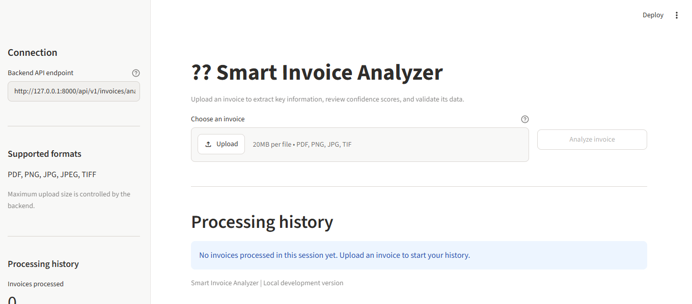
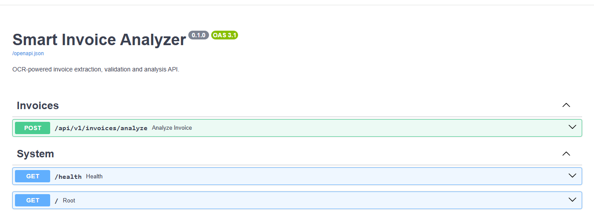

# Smart Invoice Analyzer

An OCR-powered invoice processing application that extracts, structures, and validates important information from PDF and image-based invoices.

## Overview

Smart Invoice Analyzer combines Optical Character Recognition (OCR), invoice field extraction, data validation, and a web-based interface to simplify invoice processing.

The application uses a FastAPI backend and a Streamlit frontend to provide a local invoice-processing workflow.

## Features

- Upload invoices in PDF, PNG, JPG, JPEG, and TIFF formats.
- Extract text from digital PDFs and scanned documents.
- Recognize invoice numbers, invoice dates, due dates, and supplier information.
- Extract subtotal, tax, total, and currency.
- Display OCR and field-level confidence scores.
- Validate required invoice fields and calculated totals.
- Handle invalid, empty, and unsupported uploads.
- Export processed invoice information to CSV and Excel.
- View processing history during the current Streamlit session.
- Access backend health checks and interactive API documentation.


## Application Screenshots

The following screenshots demonstrate the application's interface and main features.

### 1. Dashboard


### 2. Invoice Upload


### 3. Extraction Results


### 4. Validation


### 5. Processing History


### 6. API Documentation



## Technology Stack

| Component | Technology |
|---|---|
| Programming Language | Python 3.11 |
| OCR Engine | Tesseract OCR |
| OCR Integration | PyTesseract |
| PDF Processing | PyMuPDF |
| Backend | FastAPI |
| Frontend | Streamlit |
| Data Processing | Pandas |
| Data Validation | Pydantic |
| Automated Testing | Pytest |
| Excel Export | OpenPyXL |

## System Architecture

```text
User
  |
  v
Streamlit Frontend
  |
  v
FastAPI Backend
  |
  v
Invoice Processing Service
  |
  +---- OCR Service (Tesseract)
  |
  +---- Field Extraction
  |
  +---- Data Validation
  |
  v
Structured Invoice Results
  |
  +---- CSV Export
  |
  +---- Excel Export
```

## Project Structure

```text
Smart-Invoice-Analyzer/
|
+-- backend/
|   +-- app/
|       +-- api/
|       +-- core/
|       +-- services/
|
+-- frontend/
|
+-- data/
|   +-- test_images/
|
+-- reports/
|   +-- screenshots/
|
+-- tests/
|
+-- .env.example
+-- .gitignore
+-- LICENSE
+-- README.md
+-- pyproject.toml
+-- pytest.ini
+-- requirements.txt
+-- requirements-dev.txt
```

## Requirements

- Windows, Linux, or macOS.
- Python 3.11 or a compatible version.
- Tesseract OCR installed and accessible.
- Dependencies listed in `requirements.txt`.

## Installation and Setup

### 1. Clone the repository

```bash
git clone https://github.com/usamaellahi2022-code/Smart-Invoice-Analyzer.git
cd Smart-Invoice-Analyzer
```

### 2. Create a Python virtual environment

```bash
python -m venv .venv
```

Activate the environment on Windows PowerShell:

```powershell
.\.venv\Scripts\Activate.ps1
```

### 3. Install dependencies

```bash
python -m pip install --upgrade pip
python -m pip install -r requirements.txt
```

### 4. Configure environment variables

Create a local `.env` file from the example:

```powershell
Copy-Item .env.example .env
```

Configure the Tesseract executable and language-data paths according to your local installation.

**Important:** Never commit `.env` files or private credentials to GitHub.

### 5. Start the FastAPI backend

Open a terminal and run:

```bash
python -m uvicorn backend.app.main:app --host 127.0.0.1 --port 8000
```

Backend health endpoint:

http://127.0.0.1:8000/health

Interactive API documentation:

http://127.0.0.1:8000/docs

### 6. Start the Streamlit frontend

Open another terminal and run:

```bash
python -m streamlit run frontend/app.py --server.address 127.0.0.1 --server.port 8501 --server.maxUploadSize 20
```

Frontend:

http://127.0.0.1:8501

## Running Tests

Run the automated test suite:

```bash
python -m pytest -v
```

Check installed dependencies:

```bash
python -m pip check
```

## Quality Assurance

The completed local QA cycle recorded:

- 29 automated tests passed.
- PDF, PNG, JPG, JPEG, and TIFF upload tests passed.
- Empty and corrupt invoice handling tested.
- Valid invoice processing verified after invalid-file tests.
- Dependency check reported no broken requirements.

These results represent local development testing and do not constitute an independent security audit or production certification.

## Current Limitations

- Processing history is session-based.
- OCR accuracy depends on invoice quality, layout, language, and scan resolution.
- Tesseract OCR must be installed separately.
- The application is currently intended for local development.
- Production deployment, authentication, persistent database storage, and external integrations are not claimed as completed features.

## License

This project is licensed under the MIT License. See the [LICENSE](LICENSE) file for details.
