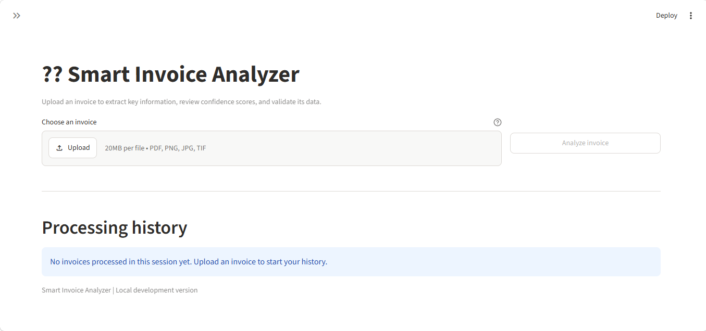
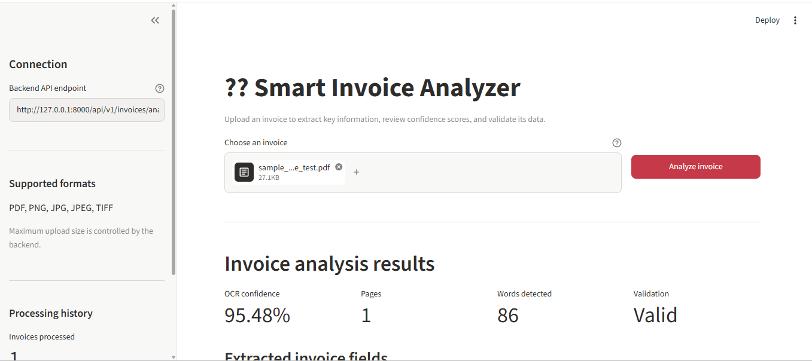
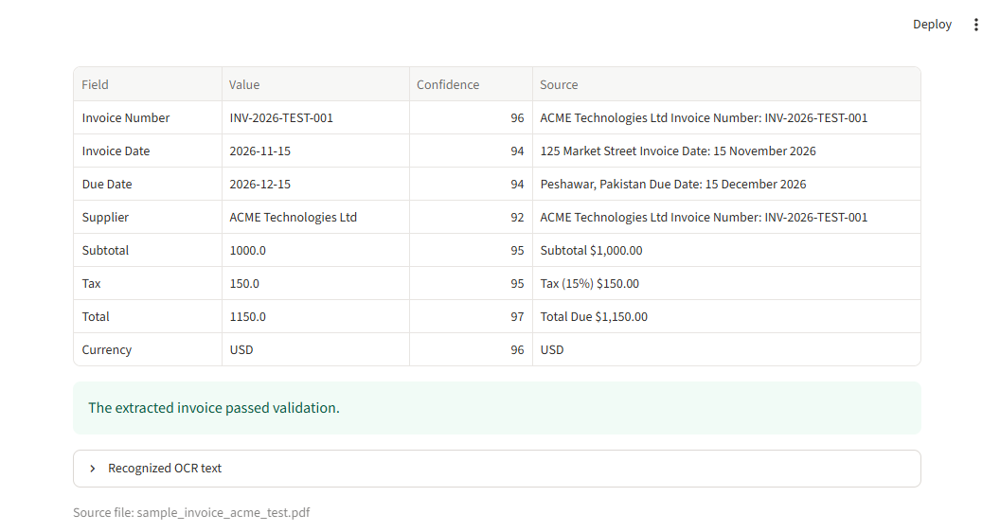
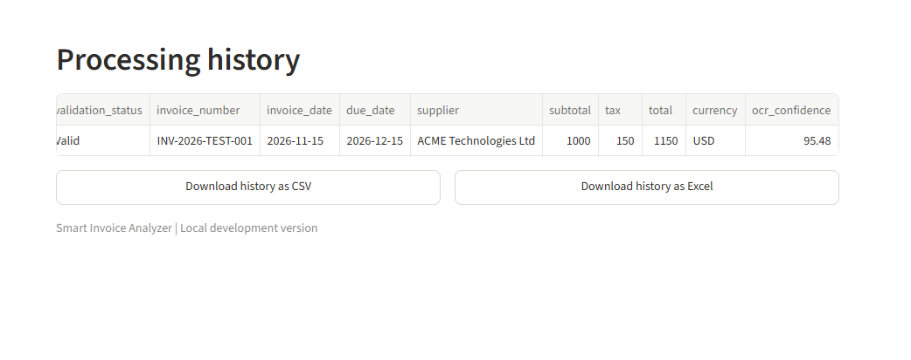

# Smart Invoice Analyzer

An OCR-powered invoice processing application that extracts, structures, and validates key information from PDF and image invoices.

## Overview

Smart Invoice Analyzer combines Optical Character Recognition (OCR), invoice field extraction, validation, and a web-based interface to simplify invoice data processing.

The application provides a local development workflow with a FastAPI backend and Streamlit frontend.

## Features

- Upload invoices in PDF, PNG, JPG, JPEG, and TIFF formats.
- Extract text from digital PDFs and scanned documents.
- Recognize invoice number, invoice date, due date, and supplier.
- Extract subtotal, tax, total, and currency.
- Display OCR and field confidence scores.
- Validate required fields and invoice totals.
- Detect invalid, empty, and unsupported uploads.
- Export processed invoice information to CSV and Excel.
- View processing history during the current Streamlit session.
- Access backend health checks and interactive API documentation.

## Application Screenshots

The following screenshots show the actual local application interface.

| Dashboard | Invoice Upload |
|---|---|
|  |  |

| Extraction Results | Validation |
|---|---|
|  |  |

| Processing History | API Documentation |
|---|---|
|  |  |

## Technology Stack

| Component | Technology |
|---|---|
| Language | Python 3.11 |
| OCR engine | Tesseract OCR |
| OCR integration | PyTesseract |
| PDF processing | PyMuPDF |
| Backend | FastAPI |
| Frontend | Streamlit |
| Data processing | Pandas |
| Validation | Pydantic |
| Testing | Pytest |
| Excel export | OpenPyXL |

## Architecture

```text
User
 |
 v
Streamlit Frontend
 |
 v
FastAPI Backend
 |
 v
Invoice Processing Service
 |
 +---- OCR Service (Tesseract)
 |
 +---- Field Extraction
 |
 +---- Validation
 |
 v
Structured Invoice Results
 |
 +---- CSV Export
 |
 +---- Excel Export
```

## Project Structure

```text
Smart-Invoice-Analyzer/
|
+-- backend/
|   +-- app/
|       +-- api/
|       +-- core/
|       +-- services/
|
+-- frontend/
|
+-- data/
|   +-- test_images/
|
+-- reports/
|   +-- screenshots/
|
+-- tests/
|
+-- .env.example
+-- .gitignore
+-- LICENSE
+-- README.md
+-- pyproject.toml
+-- pytest.ini
+-- requirements.txt
+-- requirements-dev.txt
```

## Requirements

- Windows, Linux, or macOS.
- Python 3.11 or compatible version.
- Tesseract OCR installed and accessible.
- Dependencies listed in `requirements.txt`.

## Local Setup

### 1. Clone the repository

```bash
git clone https://github.com/usamaellahi2022-code/Smart-Invoice-Analyzer.git
cd Smart-Invoice-Analyzer
```


### 2. Create a Python environment

```bash
python -m venv .venv
```

Activate it on Windows PowerShell:

```powershell
.\.venv\Scripts\Activate.ps1
```

### 3. Install dependencies

```bash
python -m pip install --upgrade pip
python -m pip install -r requirements.txt
```

### 4. Configure environment variables

Copy `.env.example` to `.env` and update the local configuration as needed.

Windows PowerShell:

```powershell
Copy-Item .env.example .env
```

Configure the Tesseract executable and language-data paths for your own installation.

Never commit `.env` or private credentials.

### 5. Start the backend

Open a terminal:

```bash
python -m uvicorn backend.app.main:app --host 127.0.0.1 --port 8000
```

Backend health endpoint:

`http://127.0.0.1:8000/health`

API documentation:

`http://127.0.0.1:8000/docs`

### 6. Start the frontend

Open another terminal:

```bash
python -m streamlit run frontend/app.py --server.address 127.0.0.1 --server.port 8501 --server.maxUploadSize 20
```

Frontend:

`http://127.0.0.1:8501`

## Running Tests

Run the automated test suite:

```bash
python -m pytest -v
```

Check installed dependencies:

```bash
python -m pip check
```

## Quality Assurance

The completed local QA cycle recorded:

- 29 automated tests passed.
- PDF, PNG, JPG, JPEG, and TIFF browser upload tests passed.
- Empty and corrupt invoice handling tested.
- Valid invoice processing verified after invalid-file tests.
- Dependency check reported no broken requirements.

These are recorded local development test results, not an independent security audit or production certification.

## Current Limitations

- Processing history is session-based.
- OCR accuracy depends on invoice quality, layout, language, and scan resolution.
- Tesseract must be installed separately.
- The application is currently intended for local development.
- Production deployment, authentication, persistent database storage, and external integrations are not claimed as completed features.

## License

This project is licensed under the MIT License. See [LICENSE](LICENSE).
